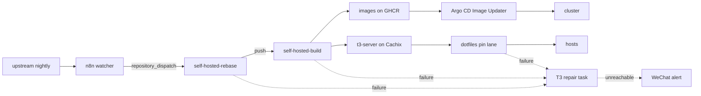

# whexy/t3code

An unofficial fork of [T3 Code](https://github.com/pingdotgg/t3code) that
follows every upstream nightly and adds a few features for Wenxuan's
self-hosted fleet. For T3 Code itself (install, docs, issues), go to
[pingdotgg/t3code](https://github.com/pingdotgg/t3code).

## What the fork adds

| Feature        | What it does                                                                                                                                                      | Ships as                                                      |
| -------------- | ----------------------------------------------------------------------------------------------------------------------------------------------------------------- | ------------------------------------------------------------- |
| Client MCP     | An MCP server that works as a T3 Code client, so an MCP client can start and follow sessions on paired T3 servers. [`apps/mcp`](../apps/mcp)                      | `ghcr.io/whexy/t3code-mcp`                                    |
| Policy Editor  | Edits the fleet's managed policy and serves it as `/policy.json`, which each host fetches before its server starts. [`apps/policy-editor`](../apps/policy-editor) | `ghcr.io/whexy/t3code-policy-editor` (private)                |
| Web Hub        | The web client, with connections kept in a shared catalog instead of one browser. [`scripts/self-hosted`](../scripts/self-hosted)                                 | `ghcr.io/whexy/t3code-hub`                                    |
| Server changes | `T3CODE_DEV_MANAGED_POLICY_PATH` gives each user their own managed policy file, and the `t3` server builds as a Nix package. [`nix`](../nix)                      | `packages.{x86_64-linux,aarch64-darwin}.t3-server`, on Cachix |

## How it stays current



A failed check tags and deploys nothing, so the last good build keeps serving.
Every failure is reported to a scheduled T3 Code task, which repairs the
branch or retries the build. The steps are in
[`self-hosted-rebase.yml`](workflows/self-hosted-rebase.yml),
[`self-hosted-build.yml`](workflows/self-hosted-build.yml) and
[`scripts/self-hosted`](../scripts/self-hosted).

## Branches and tags

- `self-hosted-nightly`, the default branch, is an upstream nightly tag, then
  the fork's commits, then one `chore(nix): pin sources for <tag>` commit.
  Every rebase replaces the pin commit, keeps it on top, and force-pushes the
  branch.
- `pin/<sha12>` tags each commit the build handed to the fleet, so it stays
  fetchable after the next force-push.
- Images are tagged `1.2.<run>` (the build workflow's run number, which only
  grows) and `sha-<sha12>`.

## Using it

The server, from the public cache:

```sh
nix run \
  --option extra-substituters https://whexy-t3code.cachix.org \
  --option extra-trusted-public-keys 'whexy-t3code.cachix.org-1:/pDSZMaQ8YHPw/og8nsuwxiYCAAcRB8JYEcmNd2Czyg=' \
  'github:whexy/t3code/<commit>#t3-server' -- --version
```

Pin a commit, not the branch, since the branch is force-pushed. As a flake
input, do not make it follow your `nixpkgs`: the cache holds only the paths
built from the fork's own lock.

The hub and MCP images are public on GHCR; take a `1.2.<run>` tag.
