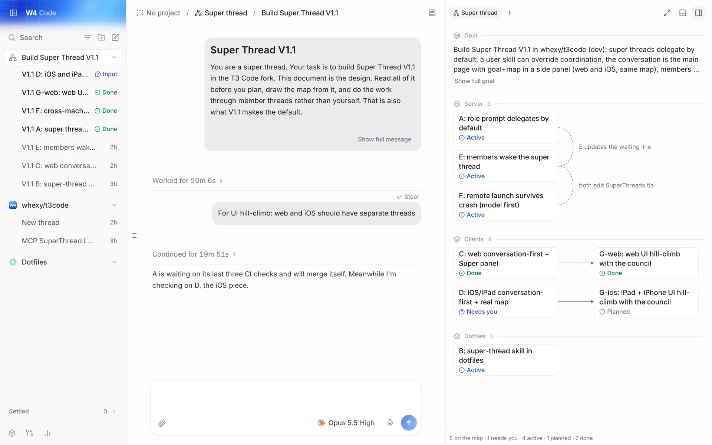
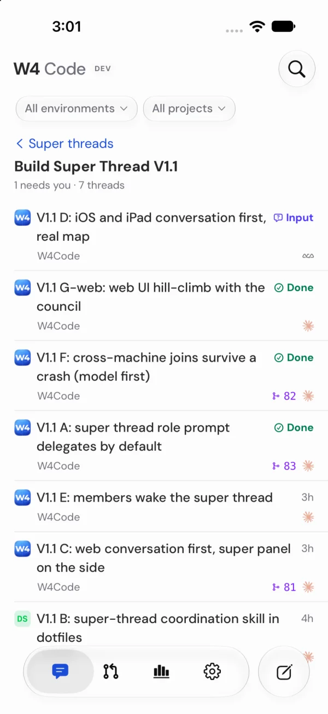

# whexy/t3code

An unofficial, experimental fork of [T3 Code](https://github.com/pingdotgg/t3code)
that follows upstream's stable releases.
For T3 Code itself (install, docs, issues), go to [pingdotgg/t3code](https://github.com/pingdotgg/t3code).

## Why the fork exists

Upstream T3 Code serves one person with a few machines well. Running a dozen of
them, mostly from a phone, without T3 Connect, ran into five gaps.

### Super threads

My tasks rarely stay in one repository, and each one needs a different set.
Moving OTA publishing onto the cluster's S3 store, for example, touched the
cluster's manifests, the OTA server, and this repository's CI. Upstream's
[multi-repo projects](https://github.com/pingdotgg/t3code/blob/main/docs/user/multi-repo-projects.md)
let one thread work across the repositories a project covers, which fits a set
that stays the same from task to task.

A super thread's agent picks the set for each task. From its memory of my
projects, it works out which repositories the task touches and where in them to
edit, then launches a thread for each piece so the pieces run at once. A piece
that spans several repositories of one project can itself be a multi-repo
thread.

Upstream already lets a thread launch threads in other projects, so one thread
can coordinate the rest. But the coordinating thread sits in the sidebar among
the threads doing the work, and with several tasks running at once, I had to
remember which thread was managing which.

A super thread keeps the manager apart from its workers. It gets its own sidebar
section, with the threads it started listed under it and ordered by which need
me first. Its agent draws its plan as a task map beside the conversation, and
wakes when one of its threads finishes, fails, or asks a question. Settling the
super thread settles its whole section. Everything underneath is upstream's
existing thread launching and messaging. See
[Super threads](../docs/user/super-threads.md).

<picture>
  <source media="(prefers-color-scheme: dark)" srcset="assets/super-thread-dark.webp">
  
</picture>



### Pairing a fleet

Without T3 Connect, each client pairs with each environment (a machine running
a T3 server) by its own link: 48 pairings for my 12 environments and 4 clients.
**Pair a device** in Settings turns a client that already reaches the fleet
into one link or set of QR codes that pairs a new client with every
environment at once.

See [Pair a device with all your environments](../docs/user/fleet-pairing.md).

### Notifications on my phone

I spend more than half my T3 Code time on my phone. Upstream's iOS
notifications and Live Activity come through T3 Connect, because only the
app's own Apple team can push to it and running that relay costs money; that
is a fair trade, not a flaw. Self-hosted, I sign the iOS app with my own team
and run my own push relay, so notifications and the Live Activity work again
without a paid service.

### An MCP that acts as a client

Each T3 server offers its own MCP endpoint, but I treat my environments as
sandboxes that can go offline at any time, so none of them is a reliable place
for one. Connecting an outside agent to each server also means granting it
permissions per server, again whenever an environment is added or removed.

The fork's MCP bridge is instead a headless T3 Code client on the cluster. It
pairs with every environment, the way an app does, and does what I could do
from an app: start, follow, answer, and file threads in any project. It can
also call a bot back when a turn ends, which is how my Grok bot drives T3 Code.

### One policy for the whole fleet

Upstream reads a [managed policy](../docs/user/managed-policy.md) from a file
on each machine. The fork adds a policy editor website, and each host's Nix
configuration names the policy it follows. A new environment starts with my
settings, and a change reaches every host within about two minutes.

## What runs where

- **Server** ([`nix`](../nix)): upstream's `t3` server as a Nix package, with a
  managed policy file per user. Runs on every dotfiles host (x86_64-linux,
  aarch64-darwin).
- **Web hub** ([`scripts/self-hosted`](../scripts/self-hosted)): the web
  client, keeping connections in a shared catalog instead of one browser. At
  `https://t3.clusters.work`.
- **MCP bridge** ([`apps/mcp`](../apps/mcp)): the client MCP above. At
  `https://t3-mcp.clusters.work/mcp`.
- **Policy editor** ([`apps/policy-editor`](../apps/policy-editor)): edits named
  policies on the tailnet at `t3-policy.at-basking.ts.net`, and serves them at
  `https://t3-policy.clusters.work/<name>.json`.
- **Push relay** ([`apps/push`](../apps/push)): turns every host's agent
  activity into the iOS app's notifications and Live Activity, replacing T3
  Connect's relay. At `https://t3-push.clusters.work`.
- **iOS app**: upstream's app, signed for my Apple team as `dev.whexy.t3code`
  and wired to the push relay. On TestFlight.
- **Desktop app**: upstream's nightly desktop app, updating from this
  repository's releases. Linux, macOS and Windows.

## How a build reaches each device


When upstream publishes a stable release, the rebase puts `dev` on top of it
and moves `self-hosted-nightly` to `dev`, which starts the build. A build publishes only
while its commit is still the branch head; otherwise the newer push publishes
instead. From there:

| Destination         | Gets                                    | How                                                                                                               | When                                                           |
| ------------------- | --------------------------------------- | ----------------------------------------------------------------------------------------------------------------- | -------------------------------------------------------------- |
| Cluster             | Hub, MCP, policy editor and push images | The build writes the `1.2.<run>` tag into clusters-work, and Argo CD rolls the apps                               | Minutes after the build                                        |
| Every dotfiles host | `t3-server`                             | dotfiles' pin lane pins the commit once Cachix has both builds; hosts switch to it and restart the server         | After dotfiles CI                                              |
| iPhone              | The app                                 | TestFlight `1.2.<run>`; client-only changes on `dev` also go [over the air](#trying-dev-before-it-ships)          | Every build                                                    |
| Desktops            | The app                                 | Mac and Windows apps update themselves from this repository's prereleases; Linux takes the AppImage dotfiles pins | Once per upstream nightly; later commits wait for the next one |

When the rebase or the build fails, nothing is published, so the last good
build keeps serving, and T3 Code starts an agent run that repairs `dev`.

## Shipping a change

Open pull requests against `dev`, the default branch. They run the checks
without the macOS leg and the desktop builds, publish nothing, and are
rebase-merged.

A merged pull request ships with the next upstream stable release. To ship it sooner,
merge the open "chore(release): promote dev to self-hosted-nightly" pull
request with a merge commit, or run
[`self-hosted-rebase.yml`](workflows/self-hosted-rebase.yml) by hand. Nobody
commits to `self-hosted-nightly` directly.

`dev` is the nightly tag upstream cut its latest stable release from, then the
fork's commits, then one `chore(nix): pin sources for <tag>` commit, then any pull requests merged since.
Every rebase replays it onto the new tag and force-pushes, so a `pin/<sha12>`
tag keeps each commit the build published fetchable.

## Trying `dev` before it ships

Each push to `dev`, and each release build, runs
[`self-hosted-dev-ota.yml`](workflows/self-hosted-dev-ota.yml). It publishes
`dev`'s client bundles to channel `dev` of the
[OTA server](https://github.com/whexy/ota) (app `t3code`), and a device that
opted into dev updates loads them:

| Client   | Bundle               | Built for the release from     |
| -------- | -------------------- | ------------------------------ |
| iPhone   | The app's JavaScript | The newest `ios/1.2.<run>` tag |
| Desktops | The renderer         | The newest desktop prerelease  |
| Web hub  | The web client       | The newest promoted hub image  |

A bundle runs on its release's servers and native code, so it is published
only when `dev` differs from that release's commit in client code alone: no
change to `packages/contracts`, and none to the iOS native fingerprint, the
desktop app's main and preload (`apps/desktop/src`), or the hub's
`server.ts` and Dockerfile. Anything else waits for the next release build;
the run summary's `dev-ota:` line says which client was skipped and why.

The workflow uploads each archive to the `ota-incoming` bucket on
`s3.clusters.work` with the `OTA_INCOMING_ACCESS_KEY_ID` and
`OTA_INCOMING_SECRET_ACCESS_KEY` key pair, which can only write, then
publishes it by that `distKey` through the OTA server's public API with
`OTA_PUBLISH_TOKEN`. It skips until all three repository secrets are set
(clusters-work `docs/ota.md`).

## Using it outside the fleet

The server, from the public cache:

```sh
nix run \
  --option extra-substituters https://whexy-t3code.cachix.org \
  --option extra-trusted-public-keys 'whexy-t3code.cachix.org-1:/pDSZMaQ8YHPw/og8nsuwxiYCAAcRB8JYEcmNd2Czyg=' \
  'github:whexy/t3code/<commit>#t3-server' -- --version
```

Pin a commit, not a branch, since both are force-pushed. As a flake input, do
not make it follow your `nixpkgs`: the cache holds only the paths built from
the fork's own lock.

The hub, MCP and push images are public at `ghcr.io/whexy/t3code-<name>`;
take a `1.2.<run>` tag. The policy editor's image is private.

## Operating it

[operations.md](operations.md) covers over-the-air iOS updates, iOS and macOS
signing, certificate renewal dates, and why upstream's workflows are disabled.
